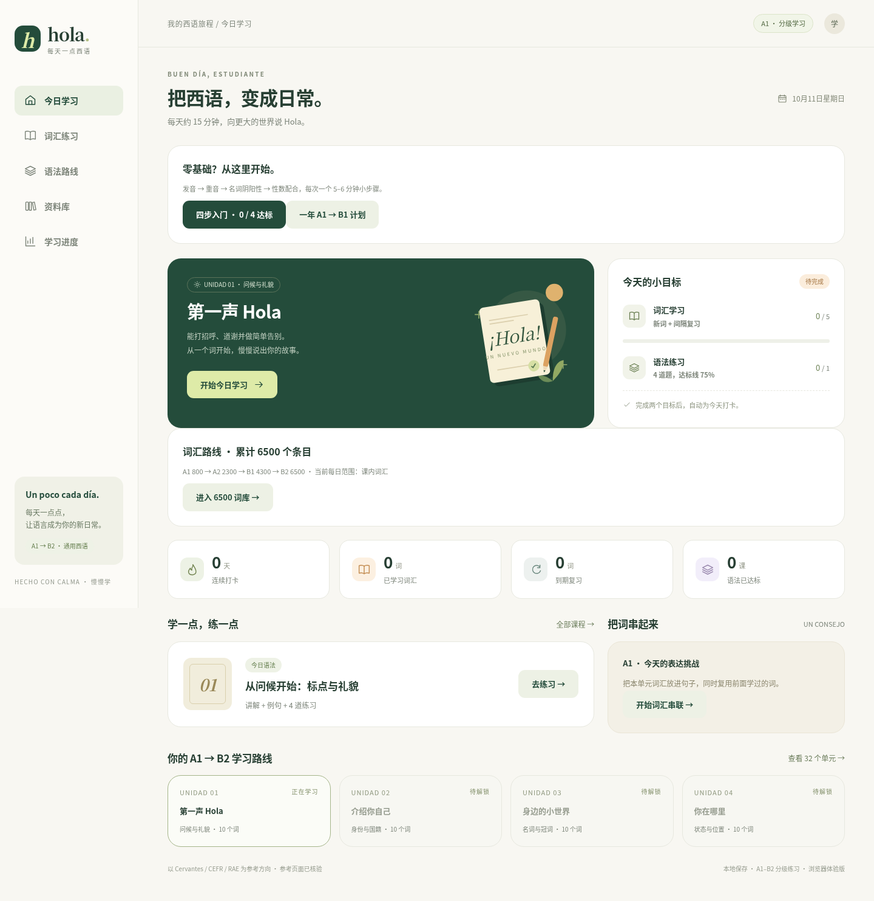

# Hola · 每天一点西语

面向中文零基础学习者的**原生微信小程序**，附可在浏览器运行的体验版。默认通用西班牙语，注明西班牙与拉美的常见用法差异。



## 已实现

- **四步入门**：发音、重音、名词阴阳性、冠词/名词/形容词配合，4 个 5–6 分钟微课与 16 道规则练习；可反复巩固，单独保存最佳分。
- **一年 A1 → B1 计划**：52 周加第 365 天复盘；A1 12 周、A2 16 周、B1 20 周及综合复盘 4 周，配套已有课程与表达任务，每周听说读写自检。

- **资料库**：16 个已在线核验的 Cervantes、欧洲委员会、RAE / ASALE 官方参考页面；按类型筛选，课程保留具体章节；另有 3 个可追溯的开源词库来源。
- **学习路线**：A1 → A2 → B1 → B2 共 32 单元、320 个词条（317 种不同词卡写法，3 个在新情景中复用）、32 节语法课、128 道选择题。每阶段 8 单元、80 词条。等级表示本课程教学顺序，非官方逐词定级。
- **6500 词库**：6,500 个去重条目，含 6,483 个单词和 17 个表达；不会把变位或重复课内语境计为新词。每页 30 词，支持西语、中文、英文搜索，按阶段解锁，每 20 词组成训练包。
- **词汇学习**：先回忆再翻卡，显示中文释义、词性、原创例句、地区说明和官方词典链接。
- **词义与拼写测验**：4 选 1、中文提示拼西语、重音与 ñ 检查、错词本与限次重练；首答正确率不受订正影响。测验中答错不计当日词汇目标。
- **词汇串联**：32 项课内表达挑战，加 1,237 组扩展表达练习（每组最多 5 个新词，覆盖全部 6,183 个新增词元），要求复用旧词；从短句到情景短文、连贯叙述与观点表达。保存草稿、检查词汇覆盖。课内任务配原创范文；扩展任务配待填写句型框架，供自行组织表达。
- **综合输出**：完成全部单元后写一份多段提案，复用 A1–B2 词汇，组织背景、目标、理由、让步和评估。
- **间隔复习**：到期词优先；忘记的词本轮再出现一次；根据自评安排下次复习。
- **语法学习**：中文讲解 → 例句 → 4 题练习 → 逐题解析 → 错题订正。
- **真实打卡**：完成当日不同词汇数量目标，并完成至少一节正确率 ≥75% 的语法练习，自动打卡。
- **进度**：连续 / 累计打卡、近 14 天日历、单元解锁、错题本、每日 3 / 5 / 10 词设置。
- **记录备份**：微信用剪贴板导出 / 导入；浏览器用 JSON 文件导出 / 导入。导入前确认替换。

课内讲解、释义、例句和题目是本站原创；扩展词库为开源派生数据，许可与署名见 [THIRD_PARTY_NOTICES.md](THIRD_PARTY_NOTICES.md)。官方参考页面和主要语法对应关系已核对；320 个词条链接均已访问核验，其中原有 80 词的基础词义与词性已逐条核对，新增 240 词仍待逐条内容复核，全部原创内容待专业教师审稿。扩展词元保留 Wiktionary 英文释义与原词条链接；中文大多由 ECDICT 英中数据中转，尚待逐条西语语境校对。新增词元的 RAE 链接仅供查询，未批量声称内容已核验。输出反馈仅检查词汇、字数、句数和连接语，不判断语法或交际质量。课程不包含完整听说读写评估或等级认证。

## 初学者先怎么用

首次进入首页，点击“四步入门”，从五个元音、h / ñ / b-v 开始；接着练重音，再把名词和 el / la 一起记，最后练冠词、名词、形容词的性数配合。包括 el día、la mano、el agua fría 等常见例外。每课读规则、看短句、自己开口，再做 4 道小练习；正确率 75% 达标。基础规则进度独立保存，不计每日词汇或语法打卡，未完成也可进入普通课程。

点击“一年 A1 → B1 计划”设置开始日期。建议从每天 20 分钟起步，逐渐到 25–30 分钟；每周安排六天练习、一天回顾或休息。可以预览以后各周，但课程按真实词汇与语法进度解锁，未来周不能提前记录周自检。日期只提供节奏建议，不会自动提升等级。

词卡页面的每日目标包括复习与新词；一年计划中的 5 / 8 / 10 个新词只是建议，可多练词包或调整节奏，不能把它当作已学数量。周自检由学习者完成后自行勾选，可反选；“已勾选周数”不是能力认证。中断后先补弱项，不强求赶日历。第 365 天整理学习档案，再通过教师反馈或合适的四技能考试判断 B1 能力。

浏览器入门例词可听设备西语合成语音；设备缺少音色时会说明。原生版本没有音频播放。本轮尚未内置分级听力材料或口语评分，计划中的听力需使用自己已有的、本阶段配有文字稿的音频。

## A1 → B2 词汇训练

| 学习阶段 | 本阶段去重词量 | 累计目标 | 扩展阶段解锁条件 |
| --- | ---: | ---: | --- |
| A1 | 800 | 800 | 零基础可开始 |
| A2 | 1500 | 2300 | A1 至少确认 640 词 + 完成 A1 的 8 个课程单元 |
| B1 | 2000 | 4300 | A2 至少确认 1200 词 + 完成 A2 的 8 个课程单元 |
| B2 | 2200 | 6500 | B1 至少确认 1600 词 + 完成 B1 的 8 个课程单元 |

在“6500 词库”启用扩展训练，今日词汇计划会优先安排到期复习，再加入已解锁范围的新词；也可直接练指定词包。每个词包分成最多 4 组表达，涵盖包内所有词。练完词卡与拼写后，用目标词和复习词写自己的内容，从 A1 短句逐步练到 B2 观点短文；最终课内综合任务要求跨阶段复用、多段论述。

以上配额与字幕词频排序是本站的学习编排，**不是官方 CEFR 逐词定级，也不保证学习 6500 词就达到 B2**。原有课内 320 张词卡继续提供原创例句与语法配套。学习统计按词元去重，旧备份会保留原 ID，并合并每日重复语境计数。

词库下载与重建（需要 Python 3 和访问原始数据域名）：

```sh
python3 scripts/build_lexicon.py --download
python3 scripts/check_lexicon.py
```

来源文件固定提交和 SHA-256，见 [来源清单](docs/lexicon-sources.json)；构建统计见 [lexicon-build.json](docs/lexicon-build.json)。已缓存数据可运行不带 `--download` 的命令重建，运行应用不需要下载源词典。主包源码约 1.20 MB，官方编译后的大小仍需微信开发者工具确认。

## 在微信开发者工具中运行

1. 安装微信官方开发者工具，导入**仓库根目录**。项目配置会将 `miniprogram/` 作为小程序根目录。
2. 导入时使用可用的测试号或自己的小程序 AppID。仓库默认是 `touristappid`，供本地体验；真机预览、上传及发布需要自己的微信小程序账号和 AppID。
3. 点击“编译”。页面、课程与学习记录均在本地运行，**不需要配置云开发、服务器、API Key 或请求域名**。
4. 按下面的验收流程检查，再用自己的账号进行真机预览。

原生版本没有外部音频请求；资料链接通过“复制链接”交给用户在浏览器中查阅。浏览器体验版另提供设备西语合成语音，语音可用性取决于系统安装的语音包，不是教材真人录音。

**验证范围**：云环境已验证共享学习逻辑、原生页面控制逻辑和浏览器交互；未在微信开发者工具中编译，也未做微信真机测试或上传发布。

## 在云环境 / 浏览器中运行

需要 Node.js ≥20。运行应用本身无第三方运行时依赖；Playwright 仅用于开发测试。

```sh
cd /workspace/spanish
npm ci --cache /tmp/hola-npm-cache --ignore-scripts --no-audit --no-fund
npm run dev
```

`dev` 构建静态体验版并监听端口 **4173**。编辑源码后重新启动会重新构建；没有热更新。可用 `PORT=另一个端口 npm run dev` 调整端口。

```sh
npm test         # 学习引擎及原生页面控制逻辑测试
npm run check    # JS / JSON 与页面注册检查，不是微信编译器
npm run build    # 生成 dist/，可部署到静态托管服务
npm run test:e2e # 桌面 + 手机浏览器交互测试
python3 scripts/check_lexicon.py # 离线核对词量、哈希、覆盖和源码包体积
python3 scripts/check_wxml.py # 可选的 WXML 标签结构检查，需要 Python 3
```

E2E 优先使用系统 `/usr/bin/chromium`；其他机器可设置 `PLAYWRIGHT_CHROMIUM_EXECUTABLE` 为已安装浏览器路径，或通过 Playwright 官方安装方式 `npx playwright install chromium` 安装。首次安装可能需要网络。云环境已有系统 Chromium，无需下载。

运行 `python3 scripts/verify_sources.py` 可重新检查官方参考页面，写入 `docs/source-verification.json`。该检查会比对页面标题，防止把 HTTP 200 的错误页当作有效资料；访问成功本身不能代替内容审阅。

运行 `python3 scripts/audit_vocabulary.py --pending-only` 可抓取新增词条的访问证据；单词重试用 `--word-id w81`。正文只在 `/tmp` 供审阅，仓库只保存链接、标题、哈希与审核状态。访问成功不自动标为内容审定。

## 手工验收

1. 首次打开，“已学习词汇”和“连续打卡”应均为 0；仅第 1 单元可学习。
2. 进入词卡，翻开释义后选择记忆反馈；“忘记了”的词应在本轮再出现一次。完成默认 5 个不同词后，仍不应打卡。
3. 完成第 1 节语法的 4 道题；答对至少 3 题，出现今日已自动打卡。
4. 关闭并重新打开，学习记录应保留；第 2 单元须在第 1 单元至少 6 个词曾确认记住或测验答对且语法达标后才解锁。
5. 做错一道题，在“我的 / 学习进度”看到错题；重练本课答对该题后，错题移除。
6. 导出备份后导入；核对词汇、打卡与错题一致。取消导入应保留当前记录。

7. 在词汇测验中故意答错，核对目标不增加；订正后错词移除，首答正确率保持原值。
8. 进入“词汇串联”，先写简短答案，查看缺项；保存草稿后重新打开，文字应保留。提交后才能看范文。
9. 在分级课程中预览 A2 / B1 / B2；后续单元可查阅词条与输出题目，练习记录按顺序解锁。完成全部单元后综合任务可提交。

## 项目结构

```text
miniprogram/
  data/course.js          # 单元、词条、语法、练习、参考章节
  data/course-extension.js # A2 / B1 / B2 分级主题、词汇与语法
  data/expression-tasks.js # 单元输出及跨阶段综合任务
  data/vocabulary-review.js # 人工核对的范围与义项说明
  data/sources.js         # 权威参考资料元数据
  lib/learning.js         # 两端共用的学习与打卡逻辑
  lib/storage.js          # 微信本地存储适配
  data/lexicon/           # 固定版本派生词库、分级词包、表达组
  pages/                  # 今日、词汇、语法、资料、进度、词卡、课程、测验与输出任务
web/                      # 浏览器体验版，共用原生课程与学习引擎
scripts/                  # 构建、开发服务、静态检查、资料核验
tests/                    # 引擎、原生页面与浏览器交互测试
docs/                     # 课程依据、开发说明、验收记录、截图
```

进入“6500 词库”：确认全部等级显示 6500 条，搜索和分页正常；A1 词包可训练，后续阶段可预览。启用扩展模式后重新打开应保留设置；在词包表达中切换组别并确认各组草稿独立保存。

## 数据与后续范围

当前版本采用 `wx.setStorageSync` / `localStorage`，没有账号、服务端或跨设备自动同步；微信和浏览器互不自动同步。清缓存、换设备前请备份。打卡按设备本地日期，不对修改设备时钟做服务端防作弊。

下一阶段可在此基础上增加微信登录与云同步、获得授权的西语真人音频、完整 A1–B2 听说读写任务、词条语境校对和内容审核流程。当前项目尚未发布到微信。

逐次建设顺序见 [迭代路线](docs/ROADMAP.md)。详细依据见 [课程与资料](docs/CURRICULUM.md)，验证结果见 [验收记录](docs/VALIDATION.md)。
